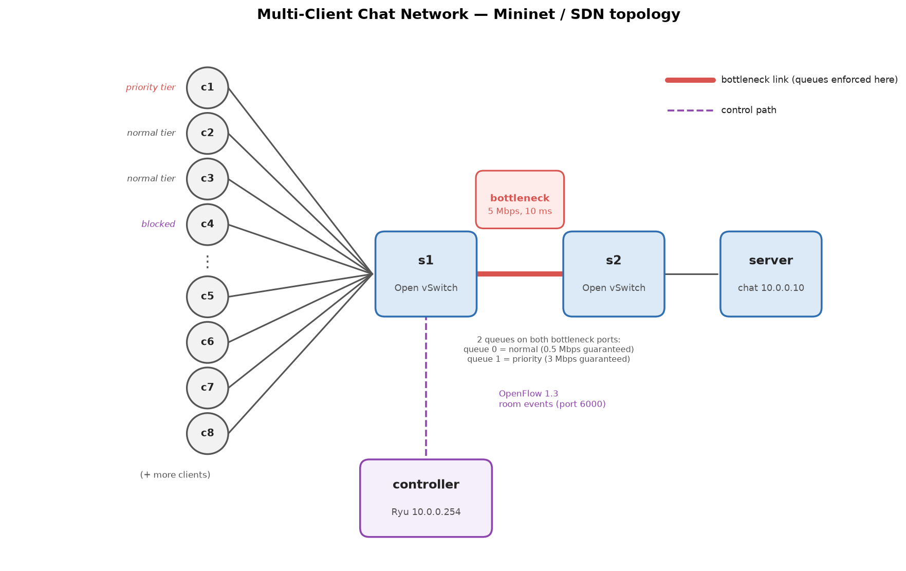
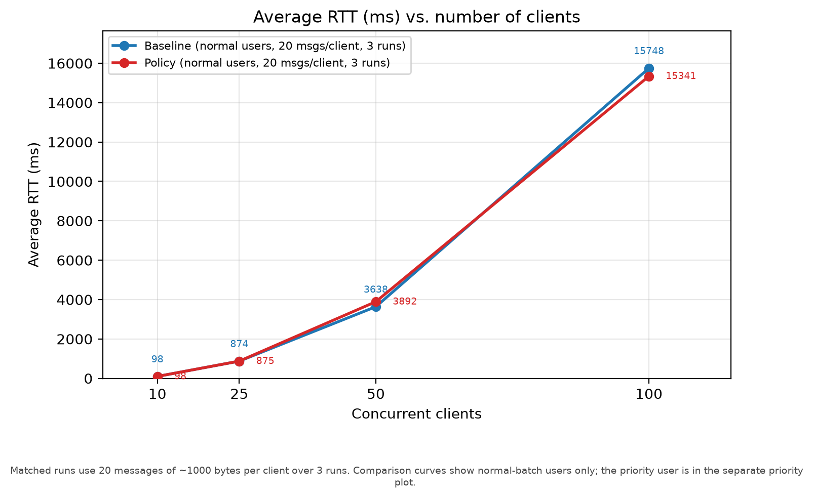
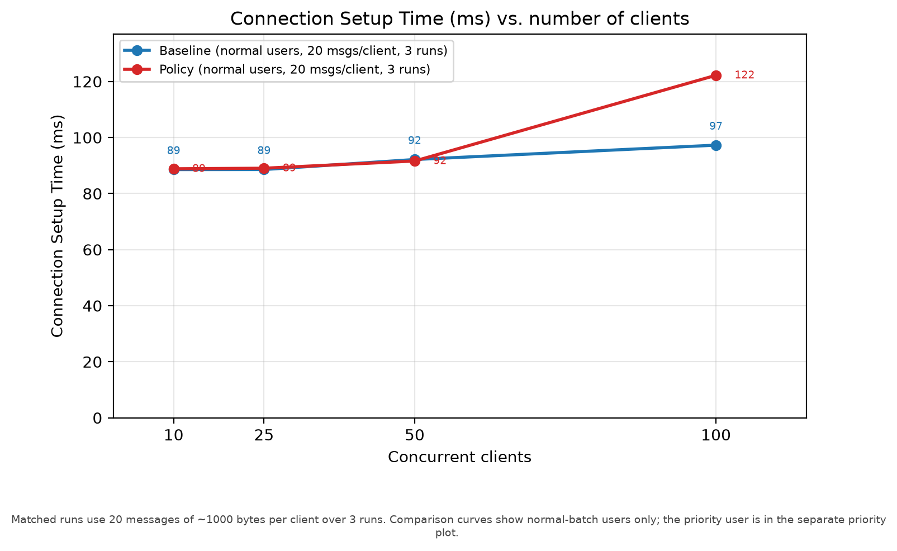
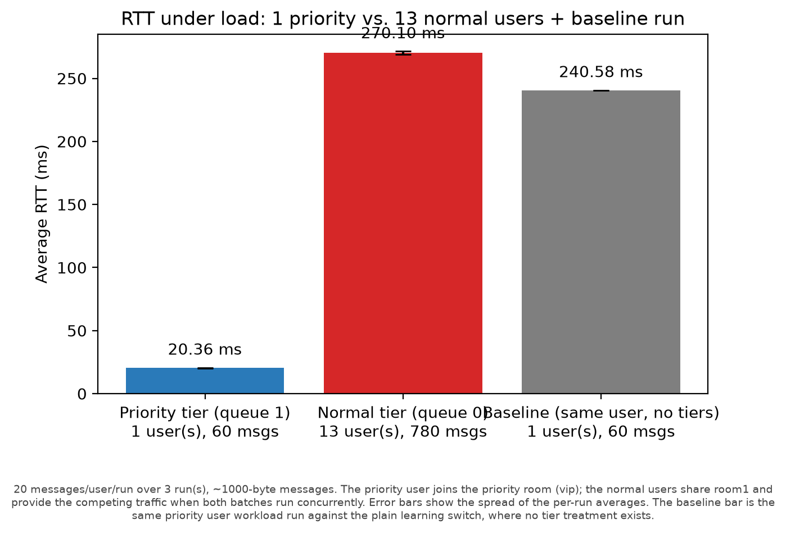

# Multi-Client Chat Network

A multi-user chat application (Python TCP sockets + threading) running on a
Mininet network with an SDN controller that classifies users into tiers,
blocks unwanted hosts, and gives priority users a faster queue on the
bottleneck link — while the system is running.

## What it does

- **Chat**: registration, login, chat rooms, room messages, private messages,
  online-user tracking. One thread per client; see `docs/protocol.md`.
- **SDN policies** (`controller/chat_controller.py`, config in
  `controller/policy.json`):
  - **Queues on the bottleneck link** — priority tier → higher-priority queue,
    normal tier → limited queue (see the table below).
  - **Dynamic priority rooms** — when a `ROOM_JOIN` / `ROOM_LEAVE` arrives
    from the chat server for a priority room (`vip`), that user's traffic
    moves to or from the priority queue **while the system is running**.
  - **Blocked users** — blocked hosts are dropped at the switch; they cannot
    even connect to the server.
  - **Readable controller log** — every policy decision is logged with the
    host, tier, queue and reason (`[POLICY] ...` lines).
- **Comparison** — the same topology runs against a plain learning-switch
  controller (`controller/baseline_controller.py`) so the policies' effect
  is measurable.

## Requirements

- Python 3 (chat server/client: standard library only)
- Ryu with OpenFlow 1.3 (bundled in `ryu-env/`)
- Mininet and Open vSwitch (for the network experiments)

## Quick start (local, no Mininet)

Terminal 1 — start the server:

```bash
python3 server/chat_server.py
```

Terminal 2 (and more for extra users) — connect a client:

```bash
CHAT_HOST=127.0.0.1 python3 client/chat_client.py
```

Ports: chat `5000`, room events `6000`, OpenFlow controller `6653`.

### Chat commands

| Command | Description |
|---|---|
| `REGISTER <user> <pass>` / `LOGIN <user> <pass>` | Account management |
| `CREATE <room>` / `JOIN <room>` / `LEAVE <room>` | Rooms |
| `MSG <room> <text>` | Send to a room |
| `PM <user> <text>` | Private message |
| `USERS` / `ROOMS` | Who's online / which rooms exist |
| `QUIT` | Disconnect |

## The SDN network

`topology/topology.py` builds the network shown below: `c1..cN` and the
controller connect to switch `s1`, which reaches the chat server through
switch `s2` over the 5 Mbps / 10 ms bottleneck link.



The `s1↔s2` link is the bottleneck. Two HTB queues live on both of its
ports:

| Queue | Tier | Guaranteed | May use up to |
|---:|---|---:|---:|
| 0 | normal | 0.5 Mbps | full 5 Mbps (borrows when priority is idle) |
| 1 | priority | 3 Mbps | full 5 Mbps |

So nobody is throttled when the link is idle — but under congestion the
priority tier keeps its 3 Mbps share and the normal tier yields.

The controller classifies chat traffic in both directions (client →
server uses source IP + TCP port 5000; server → client uses destination
IP + TCP source port 5000) into these queues. Tiers are configured in
`controller/policy.json`:

```json
{
  "priority_rooms": ["vip"],
  "default_tier": "normal",
  "hosts": {
    "10.0.0.1": "priority",
    "10.0.0.2": "normal",
    "10.0.0.3": "normal",
    "10.0.0.4": "blocked"
  }
}
```

Hosts not listed get the `default_tier`. The chat server tells the
controller about room joins/leaves on port 6000; while a user is in a
priority room, their traffic rides the priority queue — live, no restart.

## Run on Mininet

Start the controller, then the topology:

```bash
ryu-env/bin/ryu-manager controller/chat_controller.py   # terminal 1
sudo python3 topology/topology.py 25                    # terminal 2 (10/25/50/100)
```

In the Mininet CLI, start the server (it needs the controller address so its
room events reach it):

```
mininet> server bash -c 'CONTROLLER_HOST=10.0.0.254 python3 -u server/chat_server.py > /tmp/chat_server.log 2>&1 &'
mininet> xterm c1 c2 c3
```

Then chat from the client terminals with `python3 client/chat_client.py`.
Watch the controller terminal: every room join/leave is logged together with
the policy applied and the queue chosen.

## Experiments

The orchestrator automates everything — topology, controller, chat server,
one automated client per host, CSV output:

```bash
# comparison (same workload on both controllers)
sudo python3 experiments/run_mininet.py --setup ours --count 25 \
    --messages 20 --size 1000 --runs 3 --priority \
    --output experiments/results/compare_ours_25clients.csv
sudo python3 experiments/run_mininet.py --setup baseline --count 25 \
    --messages 20 --size 1000 --runs 3 --priority \
    --output experiments/results/compare_baseline_25clients.csv

# priority vs normal under load (1 priority user vs 13 normal users)
sudo python3 experiments/run_mininet.py --setup ours --count 15 \
    --messages 20 --size 1000 --runs 3 --priority --prefix norm \
    --output experiments/results/priority_load.csv

# the same workload against the baseline, for the "same user, baseline"
# bar in the priority plot
sudo python3 experiments/run_mininet.py --setup baseline --count 15 \
    --messages 20 --size 1000 --runs 3 --priority --prefix norm \
    --output experiments/results/priority_load_baseline.csv
```

Notes:

- **Start barrier** — every run connects, registers and joins all clients
  first (including the priority user), then releases them all at the same
  moment (`GO` marker in `/tmp/mn_exp/barrier_run<k>/`). This keeps the
  offered load identical in both setups; without it, staggered setups
  change how many clients overlap at the bottleneck and skew the RTT
  comparison.
- `--priority` adds one priority-tier user on `c1` (joining `vip`) in both
  setups, so results can be split by tier (`pri*` vs `norm*` usernames).
- `c1` (priority tier) and `c4` (blocked — it intentionally cannot connect)
  are excluded from the load batches.
- 100-client runs work but are slow: the 5 Mbps bottleneck serializes
  ~2 MB of offered load per sweep, so a full run takes several minutes.
  With the 120 s client response timeout every client now completes.
- Plots: `python3 experiments/plot_comparison.py` (baseline vs policy)
  and `python3 experiments/plot_priority.py
  experiments/results/priority_load_run*.csv` (priority vs normal RTT).
  Add `--baseline experiments/results/priority_load_baseline.csv` to the
  priority plot to include the same user from the baseline run.
- The comparison plot uses matched 20-message runs at 10, 25, 50 and
  100 clients for both setups. The older 5-message baseline runs are kept
  below for reference but are not plotted against the matched curves.
- The result tables and plots below come from runs using the start
  barrier (every client connects and joins first, all start sending at
  the same moment), permanent controller flows and an atomic server
  broadcast; regenerate them with the commands above.

Full procedures, result tables and discussion: [docs/architecture.md](docs/architecture.md).

## Results

### Historical baseline results

These older baseline runs used 5 messages per client and are not directly
comparable to the newer 20-message, 3-run experiments.

| Clients | Successful messages | Average RTT (ms) | Connection setup (ms) |
|---:|---:|---:|---:|
| 10 | 50/50 | 72.174 | 122.560 |
| 25 | 125/125 | 83.452 | 291.304 |
| 50 | 250/250 | 82.845 | 2368.849 |

### Matched baseline results

These baseline runs used the same workload as the controller comparison:
20 messages of ~1000 bytes per normal user over 3 runs, with a start
barrier so every client begins sending at the same moment.

| Clients | Successful messages | Average RTT (ms) | Connection setup (ms) |
|---:|---:|---:|---:|
| 10 | 480 | 97.797 | 88.556 |
| 25 | 1380 | 874.237 | 88.578 |
| 50 | 2880 | 3637.803 | 92.150 |
| 100 | 5880 | 15747.765 | 97.277 |

The counts and averages are for normal-batch users only; each run also
started one `pri1` priority user, which is analysed separately below.
All messages succeeded in both setups at every client count.

### Matched comparison (all client counts)

Both setups used 20 messages per client, 1000-byte messages, 3 runs and
the same start barrier. Averages are over normal-batch users only.

| Clients | Baseline RTT (ms) | Policy RTT (ms) | Baseline setup (ms) | Policy setup (ms) |
|---:|---:|---:|---:|---:|
| 10 | 97.797 | 97.776 | 88.556 | 88.839 |
| 25 | 874.237 | 875.041 | 88.578 | 89.042 |
| 50 | 3637.803 | 3891.880 | 92.150 | 91.616 |
| 100 | 15747.765 | 15341.250 | 97.277 | 122.199 |

While the link is uncongested (10 clients) the two setups are
indistinguishable, and once it saturates both RTT curves grow the same
way: queueing policy does not create capacity, and the differences stay
within a few percent. At 50 clients normal-tier users in the policy run
are ~7% slower — they yield to the priority tier's guaranteed share,
which is what the theory predicts. At 100 clients the per-message RTT is
effectively equal (the run is so long that per-message averages are
dominated by the shared backlog).

Connection setup time is nearly identical in both setups at every scale
(88–122 ms), which confirms the handshake is not affected by queue
policy. The policy setup adds ~25% at 100 clients (controller
round-trips during the join burst), a modest and expected cost.

The count includes the separately configured c1 priority host and c4
blocked host, so the topology has 98 normal automated client hosts.
Averages are over successful messages only; in these runs every message
succeeded.

### Priority vs. normal traffic

The priority-load experiment used 1 priority user and 13 normal users,
with 20 messages per user over 3 runs, started at the same moment by the
start barrier. The same workload was also run against the plain learning
switch, where the `pri1` user gets no tier treatment.

| Group | Successful messages | Average RTT (ms) |
|---|---:|---:|
| Priority queue (1), policy controller | 60 | 20.357 |
| Normal queue (0), policy controller | 780 | 270.096 |
| Same `pri1` user, baseline (no tiers) | 60 | 240.580 |

Under the policy controller the priority user was about 92.5% faster
than the normal tier, while under the baseline the identical workload
ran at ~241 ms — i.e. like a normal user. This isolates the effect of
the priority queue: the same traffic goes ~12× faster purely because of
its tier. This run used the controller version that classifies chat
traffic in both directions, so both the request (`tcp_dst=5000`) and
the server reply (`tcp_src=5000`) use the priority queue.

### Plots







Full procedures and discussion: [docs/architecture.md](docs/architecture.md).

## Screenshots

### Chat Server


### Chat Client


## Limitations

- Accounts and rooms are in memory; they reset when the server restarts.
- Queues and policies are only enforced on the Mininet bottleneck link —
  local testing has no SDN path.
- Room notifications require the controller to be running when the server
  reports them.

## Part B + Part C Integration Verification

The integrated SDN chat application was tested using Mininet and the Ryu controller.

Verified results:

- c1 (10.0.0.1) successfully connected to the chat server.
- Joining the `vip` room generated a `ROOM_JOIN` event.
- Ryu dynamically assigned c1 to priority queue 1.
- c2 and c3 were assigned to normal queue 0.
- c4 (10.0.0.4) was classified as blocked, with IPv4 traffic dropped at both switches.
- The Mininet ping test showed c4 unable to reach the other hosts.

Evidence: `Part_B_Integration_Evidence/README_Part_B_Integration_Evidence.md`
