# Part C — D2 Part 2 Evidence

This evidence add-on contains the screenshots supplied for the second D2 evidence set. The screenshots are embedded below so they appear directly in this README on GitHub. The original image files are also kept in `screenshots/`.

## 10-client baseline

### Screenshot 24

10-client Mininet topology and pingall connectivity test (110/110 received, 0% dropped).

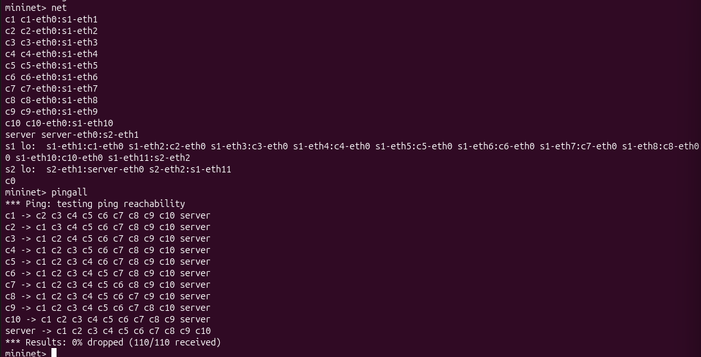

### Screenshot 25

Chat server startup and successful 10-client reachability check.

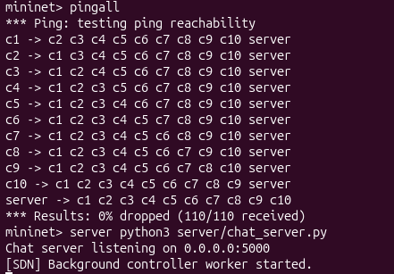

### Screenshot 26

Login and room creation for the 10-client baseline run.

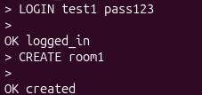

### Screenshot 27

Single-client automated run completing five messages and reporting connection setup time.

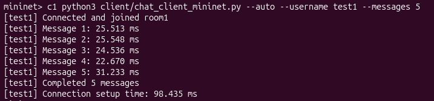

### Screenshot 28

Automated client run completing five messages.

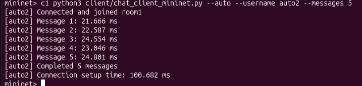

### Screenshot 29

Another automated client run completing five messages.

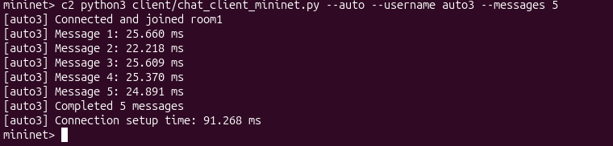

### Screenshot 30

Collection of per-client CSV outputs and connection setup measurements for the 10-client run.

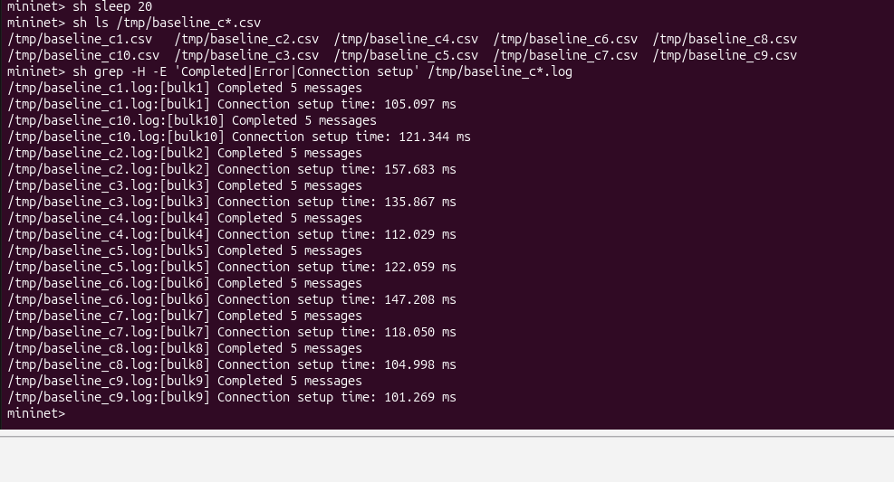

## 25-client baseline

### Screenshot 31

Registration, login, and room creation for the 25-client experiment.

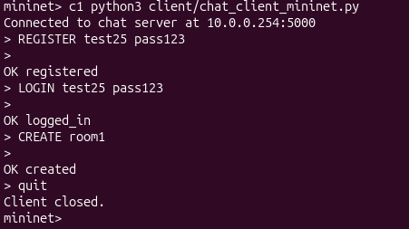

### Screenshot 32

25-client run log showing all 25 clients completed five messages.

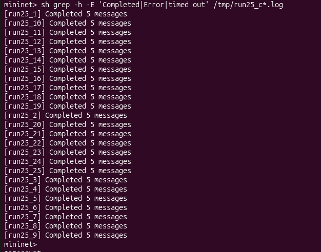

### Screenshot 33

Combined 25-client CSV row count and performance summary: 125 successful messages, 0 failures, average RTT 83.452 ms, average connection setup 291.304 ms.

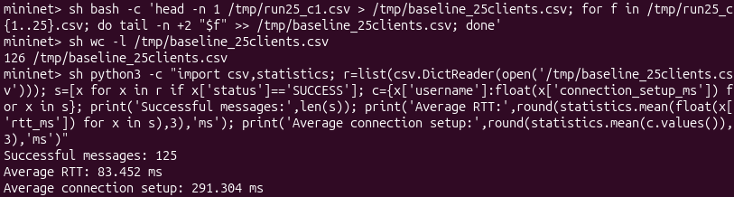

## 50-client baseline

### Screenshot 34

50-client Mininet topology startup, server setup, registration, login, and room creation.

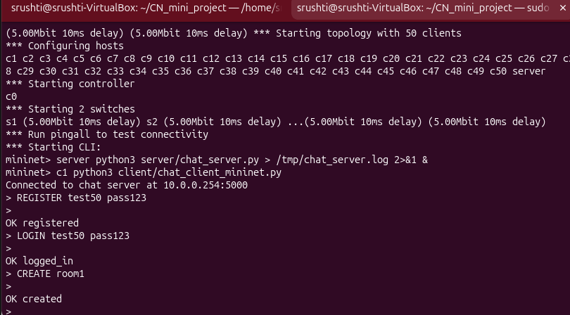

### Screenshot 35

50-client performance summary: 250 successful messages, 0 failures, average RTT 82.845 ms, average connection setup 2368.849 ms.

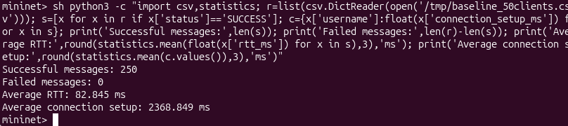

## Notes

- The 10-client connectivity screenshot records 110/110 successful reachability checks (0% dropped).
- The 25-client experiment records 125 successful messages and no failures.
- The 50-client experiment records 250 successful messages and no failures.
- These are baseline Part C performance tests; they do not by themselves demonstrate integration with the Part B policy controller.
