# Mininet-Based Computer Networks Mini-Project

## Overview

This project uses Mininet on an Ubuntu virtual machine to create and test a custom software-defined network. The recorded work includes a multi-host topology, controller and switch startup, connectivity tests, OpenFlow flow-table inspection, and a Python TCP chat client/server.

## Environment

- **Operating system:** Ubuntu running in VirtualBox
- **Network emulator:** Mininet
- **Switching:** Open vSwitch
- **Controller:** Ryu controller (as shown in the terminal screenshots)
- **Application:** Python TCP chat server and client

> Versions and exact package configuration were not recorded in the supplied screenshots.

## Project topology

The screenshots show hosts `c1`, `c2`, `c3`, and `server`, with two switches (`s1` and `s2`) and a controller. The topology is launched using a Python topology script:

```bash
cd ~/CN_mini_project
sudo python3 topology/topology.py
```

The topology script output shows the hosts being configured, two switches starting, and the Mininet CLI becoming available.

## Tests and results

### 1. Initial topology connectivity

Inside the Mininet CLI:

```text
pingall
```

The first recorded test reports **40% dropped (12/20 received)**. This indicates that some host-to-host ping attempts failed in that run. It should be treated as an initial connectivity issue, not as a fully successful connectivity test.

### 2. OpenFlow flow-table inspection

The screenshots show the flow table being inspected with:

```bash
sudo ovs-ofctl dump-flows s1
```

The output contains OpenFlow entries, including TCP-related matches and controller actions. This verifies that flow entries can be inspected on the switch.

### 3. Chat client code

The supplied screenshots show `client/chat_client.py`. The client uses Python's `socket` module and a receiver thread to print messages received from the server while allowing the user to enter commands.

The visible client configuration uses:

```python
HOST = "127.0.0.1"
PORT = 5000
```

The screenshots do not establish whether this loopback address is suitable for every Mininet-host deployment; adjust the host address to the server's reachable IP when running the client from a different network namespace.

### 4. Controller startup

A terminal screenshot shows the Ryu controller being started from the project's virtual environment:

```bash
source ryu-env/bin/activate
ryu-manager controller/chat_controller.py
```

The visible output indicates that the controller application loads and the switch connections are established.

### 5. Chat server startup

The server is started with:

```bash
python3 server/chat_server.py
```

The screenshot reports that the chat server is listening on `0.0.0.0:5000`.

### 6. Host-to-server connectivity

The Mininet CLI screenshot shows:

```text
c1 ping -c 3 server
```

The recorded result is **3 packets transmitted, 3 received, 0% packet loss**, demonstrating successful connectivity from `c1` to the server for this test.

### 7. Additional server reachability test

A further screenshot runs a ping to `10.0.0.10` from the Ubuntu terminal using `sudo mnexec` and a Mininet process ID. The displayed output reports **3 packets transmitted, 0 received, 100% packet loss** in that particular test. This differs from the successful Mininet `c1`-to-server ping, so the execution context and address should be checked if reproducing it.

### 8. TCP connection test

The screenshots show a short Python socket test connecting to `10.0.0.10` on port `5000`. The terminal prints **“TCP connection successful”**, indicating that the connection test succeeded in that run.

### 9. Chat-room creation test

A later screenshot shows a Python socket test sending a `CREATE` command to the server and then inspecting the OpenFlow flow table again. The screenshot documents the test attempt and flow-table output; it does not clearly show a complete client/server conversation, so end-to-end multi-client chat should be verified separately.

## Useful commands

| Command | Purpose |
|---|---|
| `sudo python3 topology/topology.py` | Launch the custom topology |
| `nodes` | List Mininet nodes |
| `net` | Display network connections |
| `pingall` | Test host-to-host reachability |
| `c1 ping -c 3 server` | Test reachability from `c1` to the server |
| `sudo ovs-ofctl dump-flows s1` | Inspect flow entries on switch `s1` |
| `exit` | Exit the Mininet CLI |
| `sudo mn -c` | Clean up Mininet state |

## Running checklist

1. Open the Ubuntu VM and enter the project directory.
2. Start the Ryu controller in its own terminal.
3. Start the chat server in its own terminal or in the intended Mininet host, according to the project design.
4. Launch the custom Mininet topology.
5. Run `nodes`, `net`, and connectivity tests.
6. Inspect the OpenFlow flow table.
7. Run the TCP client test and verify the chat-room behaviour.
8. Record actual outputs and any errors.

## Screenshots

Screenshots extracted from the supplied `cn_miniproject.docx` are included in the `screenshots/` directory. Each image is referenced below in the same general order as the source document.


### Screenshot 1

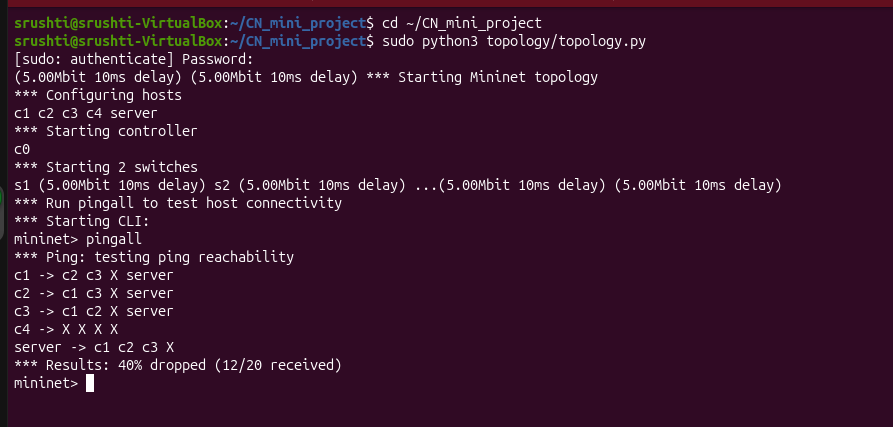

### Screenshot 2

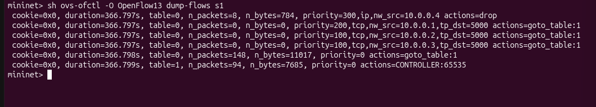

### Screenshot 3

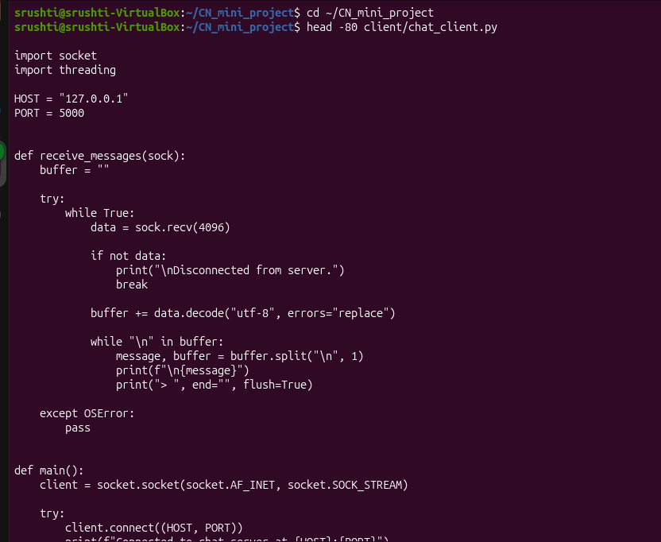

### Screenshot 4

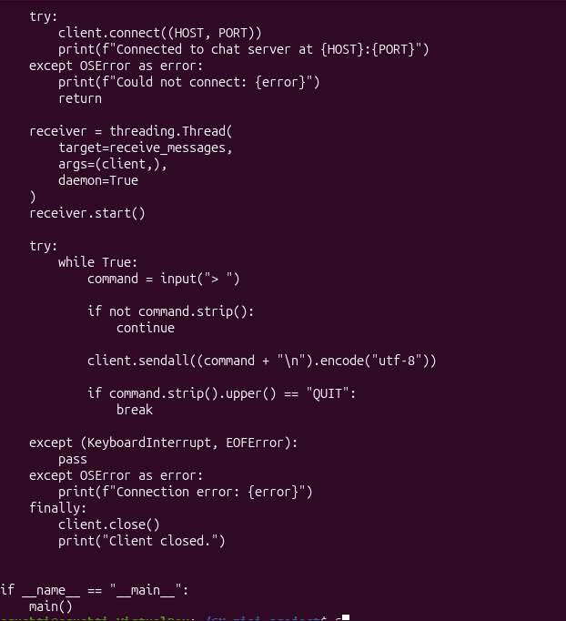

### Screenshot 5

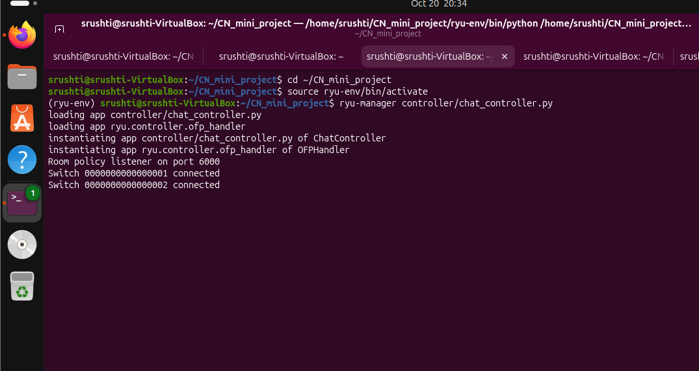

### Screenshot 6

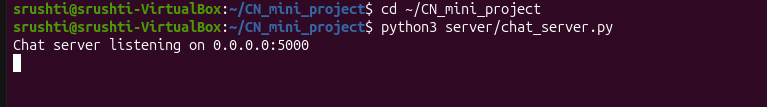

### Screenshot 7

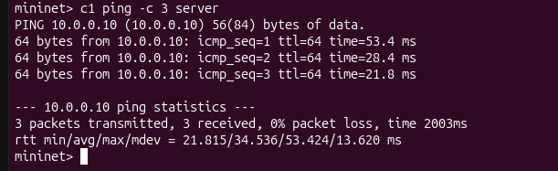

### Screenshot 8

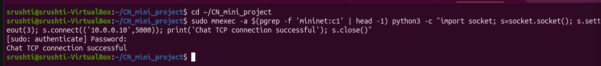

### Screenshot 9

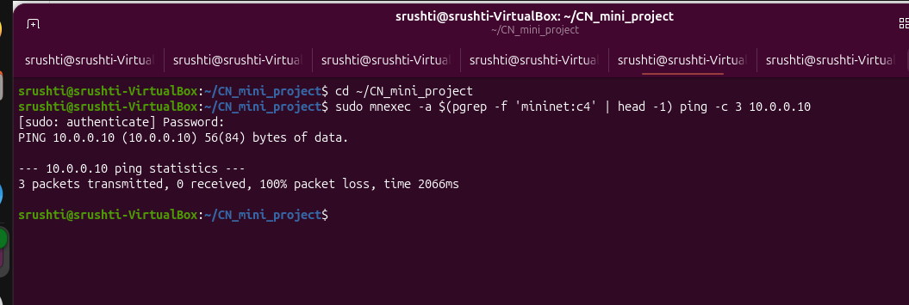

### Screenshot 10

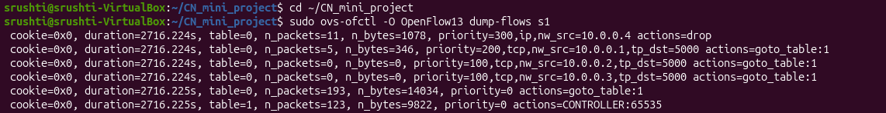

### Screenshot 11

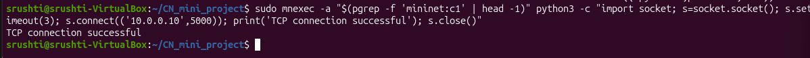

### Screenshot 12

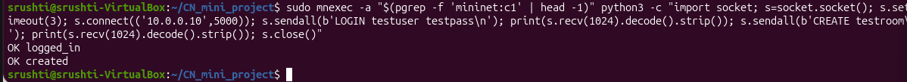

### Screenshot 13

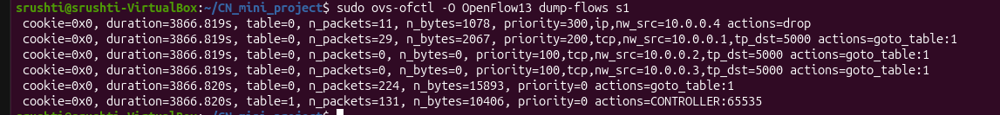

## Conclusion

The supplied evidence demonstrates that the custom Mininet topology starts, OpenFlow flow entries can be inspected, a `c1`-to-server ping succeeds in one test, and a TCP connection to the chat server succeeds in the recorded test. The initial `pingall` result shows partial packet loss, and another ping attempt shows 100% loss; these differences should be investigated and reported honestly. A complete end-to-end multi-client chat demonstration is not clearly established by the supplied screenshots.

## Notes

- Run Mininet commands such as `pingall`, `nodes`, and `net` at the `mininet>` prompt.
- Run shell commands such as `sudo ovs-ofctl ...` at the Ubuntu terminal unless they are explicitly prefixed with `sh` inside Mininet.
- Keep the controller, server, and topology running in the appropriate terminals during tests.
